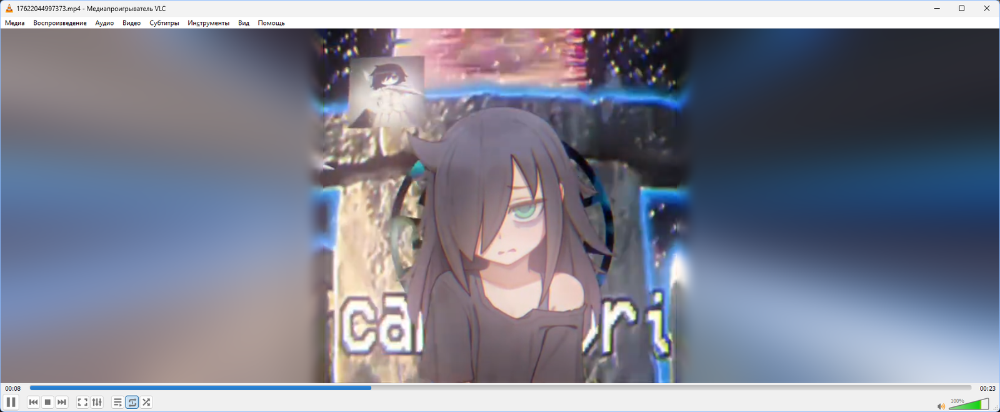
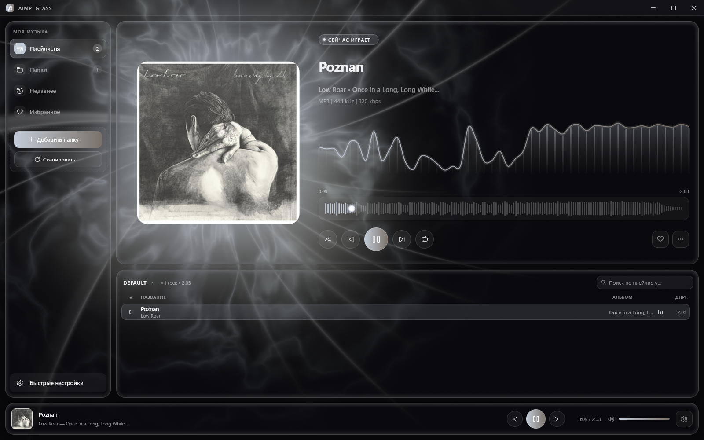

<h1 align="center">AmbientGlass</h1>

<p align="center">
  Два визуальных приложения для Windows на Direct3D 11: свечение вокруг видео в VLC и оболочка «жидкое стекло» для AIMP.
</p>

<p align="center">
  
  
  
  
  
  
</p>

## VLC Ambient Light

<p align="center">
  
  <br><sub>Снимок экрана: VLC 3 в окне, квадратное видео, по бокам — свечение.</sub>
</p>

Цвета кадра растекаются в чёрные поля вокруг видео. Это отдельная программа, `VlcAmbient.exe`, она работает рядом с обычным VLC 3, и патчить плеер не нужно.

- Свечение есть и на весь экран, и в окне. Оно заполняет поля на широком мониторе и полосы, вшитые в сам файл.
- У края картинки свечение того же цвета, что и край, и дальше уходит в фон без ступенек и полос.
- Обычное движение идёт кадр в кадр. Смену сцены и перемотку свечение не повторяет вспышкой, а мягко перетекает в новые цвета.
- Тянет 4K, HDR и 60 fps: кадры не покидают видеокарту, своя обработка занимает доли миллисекунды.
- Настройки в своей панели. Открыть её можно из меню VLC **Вид → Ambient light**, из трея или повторным запуском.

Как поставить. Соберите проект (`build.cmd`, см. [ниже](#сборка-и-тесты)) и один раз запустите `build\VlcAmbient.exe` — он сам добавит пункт меню в VLC. Потом перезапустите VLC и откройте видео. Из командной строки программа понимает `--show`, `--hide`, `--toggle`, `--quit`, `--background`, а настройки хранит в `%LOCALAPPDATA%\VlcAmbient\settings.ini`.

Чего нет. Поддерживается только VLC 3. Свечение отстаёт от картинки примерно на один кадр экрана. Путь к `VlcAmbient.exe` лучше держать латиницей.

## AimpGlass

<p align="center">
  
  <br><sub>Снимок экрана: AIMP 6 с AimpGlass во время воспроизведения.</sub>
</p>

Плагин для AIMP 6, который заменяет окно плеера своим. Воспроизведение, плейлисты и звук по-прежнему на AIMP, а окно, фон и библиотеку рисует плагин.

- Фон живой и целиком процедурный: картинок и видео в нём нет, шейдер считает его заново каждый кадр. За обложкой светится масса цвета, вокруг — ореол настоящих цветов обложки, до краёв окна тянутся лучи. На ударе фон вспыхивает, а двигается в темпе трека.
- Стекло бывает матовым или прозрачным, с матовой каймой по краю. Есть чёрно-белый режим: в тёмной теме это серебряный свет на чёрном, в светлой — негатив, чёрный свет на белом.
- Рядом с обложкой спектр в 48 полосах, под исполнителем строка вида «FLAC | 44.1 kHz | 16 bit | 867 kbps».
- В полосе перемотки настоящая волна трека, она кэшируется.
- Плейлисты AIMP с поиском и своя библиотека: папки, недавнее, избранное.
- В быстрых настройках — переходы, пауза между треками и эквалайзер AIMP, вид фона и три темы (тёмная, светлая, AMOLED).
- Меню сделаны из того же стекла. Окно не замирает, когда меню открыто или когда его тянут за край.
- Нагрузка небольшая: на RTX 4070 Super кадр 1600×1000 занимает около 0,6 мс видеокарты.

Как поставить. Нужен AIMP 6 x64 в обычной установке, версия из Microsoft Store не подойдёт. Соберите проект, закройте AIMP и положите `build\aimp_package\aimp_glass\x64\aimp_glass.dll` в `<папка AIMP>\Plugins\aimp_glass\`. При следующем запуске AIMP откроется уже AimpGlass, а классическое окно можно вернуть из меню «⋯».

Клавиши: пробел — пауза, ← → — перемотка, ↑ ↓ — громкость, Ctrl+F — поиск, Esc — закрыть меню или настройки.

Чего нет. Работает только с AIMP 6 x64. Режима «повторять один трек» в программном интерфейсе AIMP нет, так что и здесь его нет. ReplayGain и прочие тонкие настройки остаются в окне настроек AIMP.

## Сборка и тесты

Понадобятся Windows 10 или 11 и Visual Studio 2022 с C++ и Windows SDK 10.0.22621 или новее. AimpGlass собирается, только если рядом с репозиторием лежит SDK AIMP 6.00 (`..\AimpSDK\6.00\Sources\Cpp`, или путь в `AIMP_SDK_DIR`).

```bat
build.cmd        :: сборка: build\VlcAmbient.exe и build\aimp_glass.aimppack
build.cmd test   :: сборка и все тесты: модульные, эталонные рендеры, качество свечения
```

| Папка | Что внутри |
|---|---|
| `src\` | VLC Ambient Light |
| `aimp\` | AimpGlass: `core\` — окно, рендер, звук, библиотека; `plugin\` — связь с AIMP |
| `shared\` | Общий код: Direct3D, размытие, картинки, настройки, лог |
| `tests\`, `tools\` | Тесты и скрипты для отладки |

Подробности про устройство, тесты, инструменты и диагностику лежат в [docs/DEVELOPMENT.md](docs/DEVELOPMENT.md).

## Лицензия

[MIT](LICENSE). Панель настроек VLC Ambient Light построена на [Dear ImGui](https://github.com/ocornut/imgui) (MIT), текст её лицензии: [THIRD_PARTY_NOTICES.md](THIRD_PARTY_NOTICES.md).
