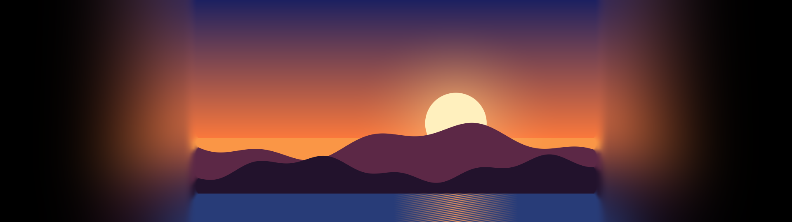

# Разработка

Как устроены обе программы, как их собирать, проверять и отлаживать. Обзор для пользователей — в [README](../README.md).

## VLC Ambient Light: как это устроено

VLC 3 не даёт плагинам рисовать за пределами кадра, поэтому свечение рисует отдельная программа `VlcAmbient.exe`:

- находит окно VLC с видео и захватывает его через Windows.Graphics.Capture (кадры остаются на GPU, HDR поддерживается);
- считает свечение шейдерами: увеличенные копии кадра, затухание к краям, размытие, цветовые фильтры;
- показывает его в двух прозрачных для мыши окнах:
  - **в полях** — над VLC, в чёрных областях вокруг картинки: боковые поля на широком мониторе и полосы, вшитые в сам файл;
  - **вокруг окна** — под VLC, на рабочем столе (только в оконном режиме; по умолчанию выключено, чтобы свечение не выходило за пределы окна VLC).

### Детали свечения

- **Охват непрерывный.** Кадр увеличивается непрерывно, поэтому «Охват» меняется плавно, без ступеней, а «Размер края» не гасит свечение ни при каком значении. Охват — это расстояние в процентах от половины длинной стороны картинки, а «Размер края» — толщина полосы по краю картинки, которая усредняется в цвет свечения.
- **Переход от картинки.** Если видео просто лежит поверх ореола, на границе видна ступенька, особенно на широком мониторе с полями. Ползунок **«Переход от картинки»** убирает её. 0 даёт резкую границу; 100 — переход шириной до 20% высоты картинки. Работает в чёрных полях: на весь экран и внутри окна VLC. Как устроено:
  - первые пиксели за краем берутся из самой картинки в полном разрешении;
  - дальше идёт «продолжение картинки» — та же проекция края, но без затухания, — всё сильнее размытое (лестница гауссовых размытий на ¼ и ½ радиуса);
  - оно плавно перетекает в обычное свечение одним весом с квинтической кривой: стык гладкий до второй производной и у картинки, и на краю перехода, яркость меняется равномерно по всей ширине, а детали растворяются размытием, а не наплывом;
  - цветовые фильтры (яркость, контраст, насыщенность) включаются по той же кривой, поэтому у самого края свечение совпадает с картинкой;
  - отрицательное «Начало затухания» не режет ступеньку у края.
- **Одинаково слева и справа.** Текстуры с mip-уровнями (копия картинки и проектор) выделяются кратными 64, а поля заполняются повтором края, поэтому уровни не сдвигаются и свечение не зависит от стороны и ширины оверлея. Сетка свечения выровнена по краю картинки.
- **Смена сцены и перемотка.** Видеокарта на каждом кадре считает, насколько он отличается от предыдущего и от текущего свечения. Обычное движение идёт без задержки. При резкой смене сцены или перемотке свечение не вспыхивает, а перетекает в новые цвета за время из ползунка **«Смена сцены и перемотка»** (по умолчанию 150 мс) с мягким стартом: два последовательных сглаживания по половине времени, без рывка и перелёта. Если смены идут подряд, как при перемотке, перетекание удлиняется до 2,5 раза. 0 — мгновенно. Состояние сглаживания хранится в FP32, поэтому даже долгая «Плавность смены цвета» доходит до цели без остаточного оттенка.
- **Задержка.** Свечение отстаёт от видео на один кадр монитора: захват окна получает кадр VLC только после того, как рабочий стол его вывел, а свечение показывается со следующим кадром. Собственная обработка — доли миллисекунды (замер в панели: «Задержка от кадра VLC»). Панель настроек не ждёт кадра монитора и не задерживает свечение, очередь кадров ограничена одним, поток работает с повышенным приоритетом.
- **Щелчок по VLC и переключение на его окно** не прячут свечение в полях даже на кадр. Оверлей полей — окно, принадлежащее окну VLC: Windows сама держит его над VLC и поднимает их вместе. Принадлежность связывает ввод двух потоков, поэтому окна оверлеев живут в отдельном лёгком потоке, который только обрабатывает сообщения и никогда не ждёт; рисование и панель — в основном потоке. Если окно оверлея пропадёт вместе с окном VLC, приложение создаёт новое.
- **Без штрихов и лучей у края.** Первые пиксели свечения берут цвет края картинки, размытый вдоль границы не меньше чем на 4 px и не меньше расстояния до края, поэтому зерно, шум и мелкие детали крайней строки расходятся конусом, а не вытягиваются в нити. Размытие вдоль края непрерывное: девять перекрывающихся выборок, каждая заранее размыта на свой шаг. Редкие резкие выборки повторяли бы границу, упирающуюся в край, веером лучей. Крайние 1–2 строки кадра пропускаются: масштабирование и сжатие часто оставляют их мягкими или шумными.
- **Без тёмной линии по шву.** VLC часто выводит крайнюю строку или столбец картинки темнее остальных: дробная область вывода смешивает их с чёрным фоном. Оверлей заходит на 1 px внутрь картинки с тех сторон, где есть поля, и закрывает эту кромку цветом края. В захваченном кадре крайние строка и столбец заменяются соседними, поэтому кромка не затемняет и само свечение.
- **Кривая затухания** размечена равномерно: каждый шаг ползунка сдвигает точку, где теряется половина света, на одну и ту же долю.
- **Шум против ступенек** добавляется после затухания и с треугольным распределением, поэтому помогает и в тёмных хвостах.
- **Поиск вшитых полос** по умолчанию выключен. Включённый, он принимает полосу только когда она почти чёрная и ровная, резко переходит в картинку и держится пару секунд на меняющихся кадрах. Тёмные сцены, виньетки, затемнения и титры на чёрном полосами не считаются.
- Раздел «Свечение» показывает размеры охвата, размытия, края и перехода в пикселях для текущей картинки. Ползунки «Цвет для HDR-видео» неактивны, пока в видео нет HDR-яркостей.


## Сборка

`build.cmd` — обёртка над CMake: настраивает `build\` при первом запуске, затем собирает. `build.cmd test` после сборки прогоняет тесты, `build.cmd clean` настраивает заново. То же руками:

```bat
cmake -S . -B build -G Ninja -DCMAKE_BUILD_TYPE=Release
cmake --build build
ctest --test-dir build --output-on-failure
```

Шейдеры (`src\glow.hlsl`, `aimp\core\glass.hlsl`, `shared\blur.hlsl`) компилируются `fxc` на этапе сборки и вшиваются в exe и dll, ошибки в HLSL видны при сборке.

## Общий код

`shared\` — статическая библиотека `shared_core`, на ней собираются обе программы.

| Файл | За что отвечает |
|---|---|
| `shared\common.cpp` | UTF-8 ↔ UTF-16, `Trim`, чтение и атомарная запись файла целиком, помощники для `RECT` |
| `shared\log.cpp` | Лог с ограничением размера; приложение пишет его в `%LOCALAPPDATA%\VlcAmbient\log.txt`, последняя ошибка показывается в панели |
| `shared\settings_ini.h` | Настройки из любого X-макро-списка: поля, ограничение диапазонов, чтение и запись ini |
| `shared\d3d_helpers.cpp`, `blur.hlsl`, `fullscreen.hlsli` | Текстуры с мипами, полноэкранные проходы (один или несколько RTV, до 5 SRV, константный буфер), раздельное гауссово размытие |
| `shared\wic_image.cpp` | Загрузка PNG/JPG через WIC в линейные FP16 (из файла или из памяти), запись PNG |

## VLC Ambient Light в исходниках

Файлы в `src\`.

| Файл | За что отвечает |
|---|---|
| `app.cpp` | Планировщик: цикл ожидания кадров, команд и событий окон; связывает остальные модули |
| `vlc_tracker.cpp` | Находит окно VLC с видео и его прямоугольники |
| `frame_source.cpp`, `capture.cpp` | Захват окна через Windows.Graphics.Capture, вырезание картинки, темп считывания яркости |
| `layout.cpp` | Чистая функция: состояние VLC + полосы + настройки → где рисовать внутренний и внешний оверлеи |
| `bar_detector.cpp` | Чистый детектор вшитых полос по сетке яркости |
| `glow_math.cpp` | Размеры свечения в пикселях, кривая затухания, сочность |
| `renderer.cpp`, `glow.hlsl` | GPU: проектор, свечение, финальный проход в заданный RTV; размытие и проходы из `shared\` |
| `overlay.cpp`, `zorder.cpp`, `window_thread.cpp` | Прозрачные для мыши окна, их поток сообщений и порядок относительно VLC |
| `panel.cpp` | Панель настроек на Dear ImGui |
| `settings.cpp` | Список настроек `VA_SETTINGS` и их ini |
| `ipc.cpp` | Файлы `command`, `alive`, `exe_path` для Lua-расширения VLC и второго экземпляра |
| `tray.cpp`, `system_integration.cpp`, `display_info.cpp` | Значок в трее, установка пункта меню VLC и автозапуска, уровень белого SDR |
| `render_cli.cpp` | Режим `--render` без VLC и окон |

## Режим `--render`



Рисует один кадр свечения из PNG настоящим конвейером на программном устройстве WARP, поэтому результат одинаков на любой машине:

```bat
build\VlcAmbient.exe --render in.png out.png [--settings file.ini] [--set spread=30 ...] [--size WxH] [--frame l,t,r,b] [--hole l,t,r,b] [--pass l,t,r,b] [--crop l,t,r,b] [--opaque] [--white 2.5] [--hdr] [--seed 0] [--prev before.png --dt 16.7 --steps 1]
```

`--frame` — где картинка внутри выходного изображения, `--hole` — прозрачная область, `--pass` — полный прямоугольник картинки при вшитых полосах (если он отличается от `--frame`, содержимое полос проходит сквозь свечение, как в приложении), `--crop` — доли картинки, с которых берётся цвет. `--prev` — предыдущий кадр того же размера: свечение начинается с него и делает `--steps` шагов по `--dt` мс к входной картинке, как в приложении (так проверяется поведение во времени). Белый уровень SDR (`--white`) в PNG отображается в 255. Без аргументов размер выхода — картинка плюс 25% с каждой стороны. Запуск без ключей печатает справку со списком всех ключей настроек.

## Тесты

`build.cmd test` (или `ctest --test-dir build`) запускает пять наборов: три для VLC Ambient Light и два для AimpGlass.

- **unit** — `tests\*.cpp`, без GPU на собственном мини-фреймворке: разбор и сохранение настроек, монотонность геометрии свечения по охвату и размытию, детектор полос на синтетических сетках, раскладка оверлеев. Собираются в `build\vlcambient_tests.exe`. Подробности: [tests/README.md](../tests/README.md).
- **golden** — 23 эталонные картинки через `--render`: `tools\golden.ps1` рендерит случаи из `tests\golden\cases.txt` и сравнивает с `tests\golden\expected\` по PSNR (порог 45 дБ); `tools\golden.ps1 -Update` обновляет эталоны.
- **quality** — `tests\quality\check_quality.py` (Python, только стандартная библиотека): 70 количественных проверок стыка картинки и свечения и поведения во времени (малое изменение без задержки, смена сцены без вспышки и с завершением к 300 мс). Профиль яркости от края наружу не должен иметь провалов, изломов и «полок»; свечение слева и справа от зеркальной картинки совпадает и не зависит от ширины оверлея; первые пиксели повторяют детали края; отрицательное «Начало затухания» не даёт ступеньки; резкая диагональная граница, упирающаяся в край, расходится одним мягким конусом, а не веером лучей. Пороги и что каждая проверка ловит: [tests/quality/README.md](../tests/quality/README.md).
- **aimp_unit** — `tests\aimp\*.cpp`, `build\aimp\aimp_tests.exe`: палитра на синтетических обложках, бит-детектор (клик 120 и 174 BPM — ровно один бит на удар при ровной и рваной частоте кадров, ровный шум и тишина — ни одного), полосы спектра, свёртка волны и её кэш, строка формата файла, поиск, библиотека, раскладка окна на десяти размерах, стеклянные меню (место под кнопкой, попадания, клавиатура), а также темп по интервалам между битами и громкость относительно пика, измерения фона на WARP: лучи доходят до дальнего края окна и без лучей его не освещают, удар делает массу у обложки ярче, стекло остаётся тёмным, прозрачное стекло показывает фон чётко при матовой кайме, чёрно-белый фон не содержит цвета, в светлой теме он становится негативом, узор фона сохраняет масштаб через час и через 10 часов работы (смещения шума ограничены, поток нитей идёт циклами), свечение обложки заметно вокруг неё.
- **Производительность AimpGlass** — `build\aimp\aimp_tests.exe --bench [W H]` рисует 600 кадров на видеокарте и печатает время каждого прохода (фон, mip-уровни, размытие стекла, сборка, интерфейс Direct2D) и время подготовки кадра на процессоре. Интерфейс держит раскладки текста и градиенты между кадрами: создавать их заново каждый кадр стоило большую часть кадра при 240 Гц.
- **aimp_golden** — восемь состояний окна (в том числе открытое меню «⋯») на WARP против `tests\aimp\golden\*.png` по PSNR (порог 40 дБ); `aimp_tests --golden tests\aimp\golden --update` обновляет эталоны, `aimp_tests --render <папка>` сохраняет демонстрационные кадры.

## AimpGlass в исходниках

Плагин собирается, только если найден SDK AIMP 6.00 (заголовки C++; в репозиторий не входит). По умолчанию он ищется рядом с репозиторием в `..\AimpSDK\6.00\Sources\Cpp`, другой путь задаётся `-DAIMP_SDK_DIR=...` или переменной окружения `AIMP_SDK_DIR`. Без SDK собираются ядро и все тесты.

| Файл | За что отвечает |
|---|---|
| `aimp\core\glass.hlsl`, `gpu_scene.cpp` | Фон (масса, нити, лучи), размытие для стекла, сборка стеклянных панелей и свечения обложки, слои быстрых настроек и меню |
| `aimp\core\ui_painter.cpp` | Текст, иконки, обложка, спектр, волна и все элементы управления на Direct2D и DirectWrite |
| `aimp\core\glass_window.cpp` | Окно без рамки на своём потоке: цепочка обмена, частота кадров, ввод, анимации |
| `aimp\core\layout.cpp`, `ui_state.cpp` | Раскладка окна, меню и проверка попадания — чистые функции |
| `aimp\core\palette.cpp`, `beat.cpp`, `audio.cpp` | Цвета из обложки (Oklab, k-means), бит и полосы спектра |
| `aimp\core\waveform.cpp`, `search.cpp`, `library.cpp` | Волна трека и её кэш, поиск, папки, недавнее и избранное |
| `aimp\core\offscreen.cpp` | Рендер кадра без окна для тестов |
| `aimp\plugin\plugin.cpp` | Связь с AIMP: события, спектр, обложки, плейлисты, декодирование волны, скрытие окна AIMP, пункт меню |

## Инструменты

Скрипты в `tools\` для разработки и диагностики. Python-скрипты используют только стандартную библиотеку, PowerShell-скрипты работают в Windows PowerShell 5.1.

| Скрипт | Для чего |
|---|---|
| `seam_view.py` | Рендерит картинку или синтетический вход в геометрии 32:9, вклеивает её в дыру, пишет увеличенный кроп шва и профили яркости. Ключи `--dark-rim` и `--cover` имитируют тёмную кромку VLC и её закрытие |
| `golden.ps1` | Эталонные тесты `--render`; `-Update` обновляет эталоны |
| `screenshot.ps1` | Снимок основного монитора вместе с прозрачными окнами, с обрезкой и уменьшением |
| `glowprofile.ps1` | Яркость вдоль строки снимка: докуда доходит свечение |
| `runwith.ps1` | Перезапуск приложения с другими настройками и снимок экрана |
| `zcheck.ps1` | Переключает фокус с VLC и обратно и проверяет, что оверлей остаётся прямо над VLC |
| `winenum.ps1` | Окна процесса VLC: классы, заголовки, прямоугольники |
| `hdrinfo.ps1` | Включён ли HDR на каждом дисплее и уровень белого SDR |
| `make_icon.py` | Генерирует значок `src\app.icon.ico` |

```bat
python tools\seam_view.py synthetic:diag out --side R --dark-rim 50 --cover 1
```

## Диагностика

- Лог: `%LOCALAPPDATA%\VlcAmbient\log.txt` (ограничен по размеру). Туда попадают ошибки захвата с кодами HRESULT, потеря GPU-устройства, проблемы с файлами настроек и пункта меню. Последняя ошибка видна и в блоке статуса панели.
- При потере GPU-устройства (обновление драйвера) программа перезапускает себя, не больше трёх раз подряд.
- AimpGlass пишет свой лог в `%LOCALAPPDATA%\AimpGlass\log.txt`: события плагина, ошибки Direct3D, декодирования волны и открытия папок. С переменной окружения `AIMPGLASS_AUDIO_LOG=1` раз в 10 секунд туда же пишутся число битов и средние уровни звука.

## Участие в разработке

- Перед изменением и после него запускайте `build.cmd test`: все наборы должны пройти.
- Если запущен `VlcAmbient.exe`, закройте его перед сборкой, иначе линковщик не сможет перезаписать exe. Новую `aimp_glass.dll` кладите в папку плагинов при закрытом AIMP.
- Каждому исправленному визуальному дефекту нужна проверка в `tests\quality`: синтетический вход, метрика и порог, который отличает сборку с дефектом от исправленной. Существующие проверки и их пороги описаны в [tests/quality/README.md](../tests/quality/README.md).
- Эталоны golden обновляйте через `tools\golden.ps1 -Update` (для AimpGlass — `aimp_tests --golden tests\aimp\golden --update`) только после осознанного изменения картинки и при зелёных остальных наборах.
